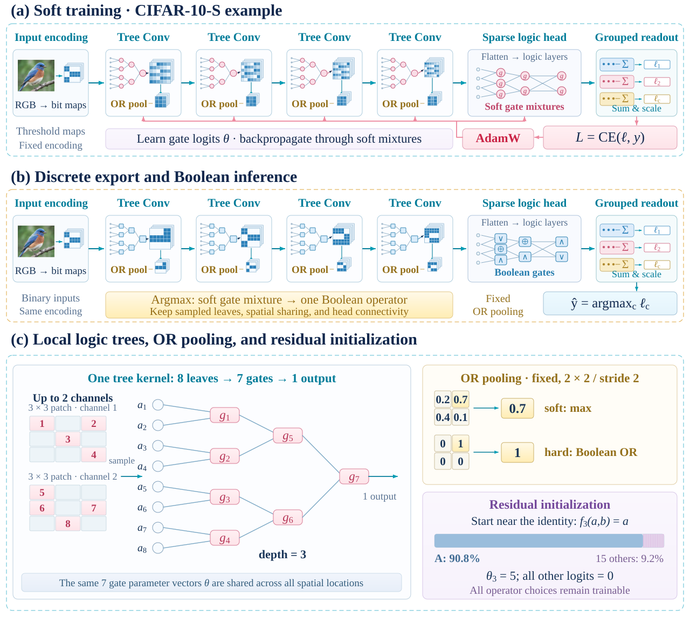
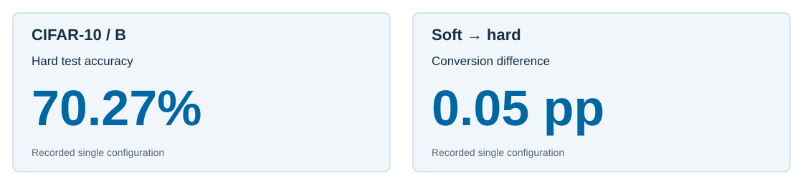

# Conv-DLGN: Convolutional Differentiable Logic-Gate Networks

**English** | [简体中文](README.zh-CN.md)

**Spatial logic-tree features with faithful discrete gate export.**

An independent PyTorch reproduction of [Convolutional Differentiable Logic Gate Networks (NeurIPS 2024)](https://arxiv.org/abs/2411.04732), combining spatially shared local logic trees, OR pooling, sparse classification, and test-time discrete Boolean gate selection. The underlying convolutional logic-tree method is credited to the original authors in [REFERENCE_NOTES.md](REFERENCE_NOTES.md).

## Abstract

Extending learned Boolean gates to image understanding requires spatial feature extraction and a reliable transition from trainable operator mixtures to discrete execution. Conv-DLGN reproduces convolutional depth-three logic trees with shared spatial weights, OR pooling, and a sparse logic classification head. Each gate is optimized as a mixture of 16 two-input Boolean operators and exported by selecting its learned operator. A representative CIFAR-10 B configuration achieves **70.32% soft** and **70.27% hard test accuracy**, corresponding to just **0.05 percentage points** of conversion difference. The paired evaluation directly demonstrates that the selected model retains classification performance after operator discretization.

## Contributions

1. **Spatially shared Boolean feature extraction.** Eight sampled leaves and seven two-input gates per tree define compact local operations that propagate feature maps through a convolutional hierarchy.
2. **End-to-end train/export integration.** Operator mixtures, fixed connectivity, initialization, OR pooling, sparse head, and hard checkpoint evaluation are consolidated into one readable PyTorch pipeline.
3. **Direct evidence for discrete logic fidelity.** The CIFAR-10 B result establishes **70.27% hard test accuracy with a 0.05 pp soft-to-hard gap** on a matched checkpoint.

## Methodology

Conv-DLGN reuses a learned depth-three logic tree at every spatial location, then downsamples its feature maps with fixed OR pooling.



*Figure 1. Conv-DLGN training, export, and local computation. (a) Soft training of CIFAR-10-S; feature sizes are shown after each pooling step. (b) Argmax export preserves sampled leaves, spatial parameter sharing, and sparse head wiring for Boolean inference. (c) Each depth-three kernel combines eight leaves through seven gates; OR pooling uses max during training, and residual initialization favors identity A. RGB input and pooling values are illustrative.*

[View the full-size SVG](docs/figures/overview.svg)

**Convolutional logic tree.** For every output channel, the [convolutional layer](src/models/conv_logic_tree_layer.py) chooses eight fixed local inputs (from up to two channels) and combines them through three levels of binary logic gates. The same operator parameters are shared across spatial locations. The [network](src/models/logic_tree_net.py) stacks these blocks and uses [OR pooling](src/models/or_pool.py) before its three-layer sparse classification head.

**Differentiable gates and export.** During training, each gate learns a softmax mixture of 16 Boolean operators, while residual initialization favors the identity operator. During export, each gate adopts its highest-logit Boolean operator; the tree structure and sparse connectivity are preserved by the [hard network](src/models/hard_logic_tree_net.py).

## Experiments

**Main finding — discrete export preserves the CIFAR-10 B operating point.** Paired checkpoint evaluation is the primary test: the hard network is measured directly after replacing trainable mixtures with selected Boolean operators.



*Figure 2. Main result on CIFAR-10 B: 70.27% hard accuracy and 0.05 pp conversion difference.*

| Dataset / profile | Soft test accuracy ↑ | Hard test accuracy ↑ | Soft − hard (pp) ↓ |
|:--|--:|--:|--:|
| MNIST / S | 98.49% | 97.55% | 0.94 |
| CIFAR-10 / S | 58.93% | 57.20% | 1.73 |
| **CIFAR-10 / B** | **70.32%** | **70.27%** | **0.05** |

*Table 1. Reported completed local configurations. Soft and hard values within each row correspond to the same selected model; rows use different profiles and training settings.*

**Evidence interpretation.** CIFAR-10 B retains approximately **99.93%** of soft accuracy after discrete gate selection (70.27 / 70.32), demonstrating high conversion fidelity at this operating point. MNIST S and CIFAR-10 S provide additional paired measurements of the export path.

**Protocol.** Checkpoints are selected by validation soft accuracy; test accuracy is then reported for soft and exported versions. Results reflect individual completed configurations. CIFAR-10 profiles can use threshold or bit-plane encoding, and teacher-enabled configurations require an external teacher checkpoint; inspect [profile YAMLs](configs/paper_table6/) before reproduction. The repository reports classification accuracy through PyTorch; any hardware throughput or energy claim requires its own measurement. Historical weights and raw training histories are stored outside this source repository.

## Getting started

```bash
python3 -m venv .venv
source .venv/bin/activate
pip install -r requirements.txt

# Run configured local experiments
python src/train.py --config configs/paper_table6/mnist_s.yaml
python src/train.py --config configs/paper_table6/cifar10_s.yaml

# Evaluation and gate export with your generated checkpoint
python src/evaluate.py --checkpoint path/to/checkpoint.pt
python src/discretize.py --checkpoint path/to/checkpoint.pt
python -m pytest tests -v
```

The commands start new experiments; Table 1 records previously completed runs and is not a promise of bitwise identical outcomes in a new training environment.

## Repository map

| Path | Purpose |
|:--|:--|
| [configs/paper_table6/](configs/paper_table6/) | MNIST/CIFAR-10 training profiles |
| [src/models/](src/models/) | Trainable and hard logic-tree networks |
| [src/ops/](src/ops/) | Boolean gate algebra |
| [MODEL_LAYER_SUMMARY.md](MODEL_LAYER_SUMMARY.md) | Layer-by-layer model explanation |
| [REFERENCE_NOTES.md](REFERENCE_NOTES.md) | Method credits and reproduction scope |

## Takeaway

**Convolutional logic features can be learned continuously and exported as explicit Boolean gates with closely matched test performance**: CIFAR-10 B yields **70.27% hard accuracy, 0.05 pp from soft execution**.
